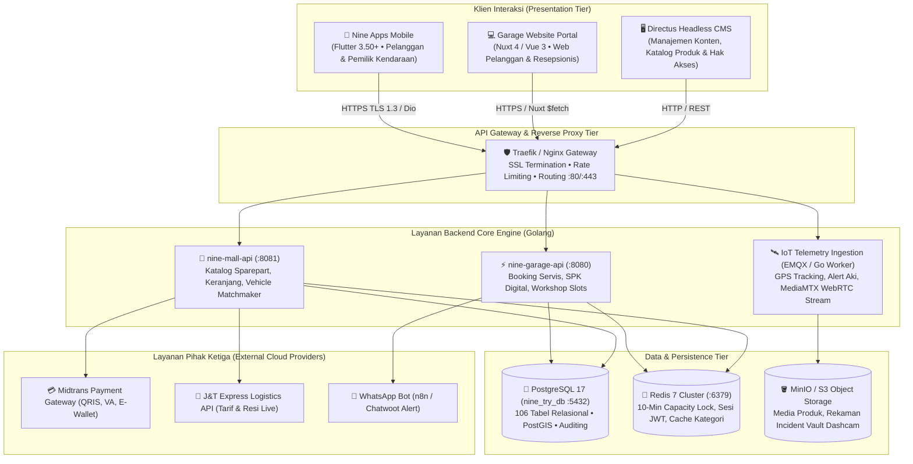
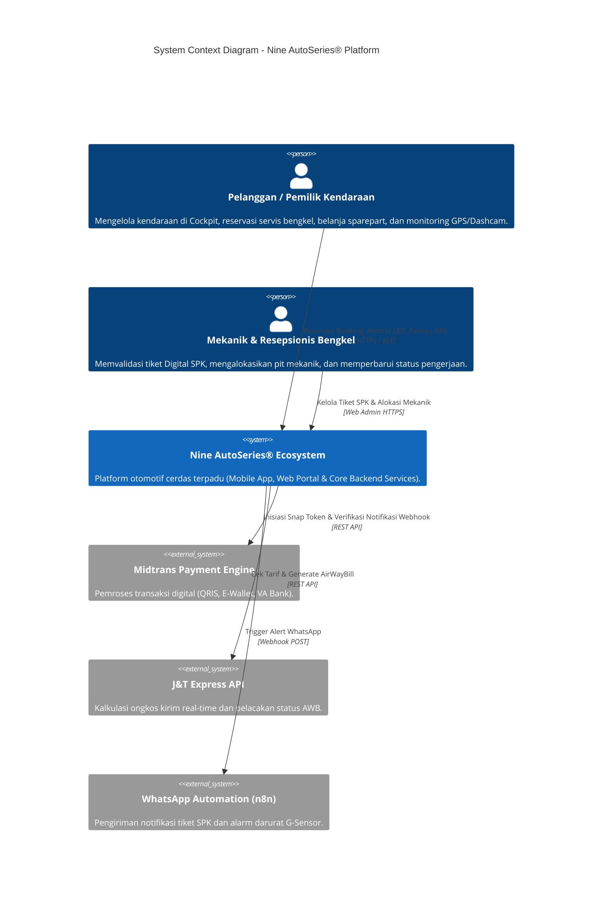
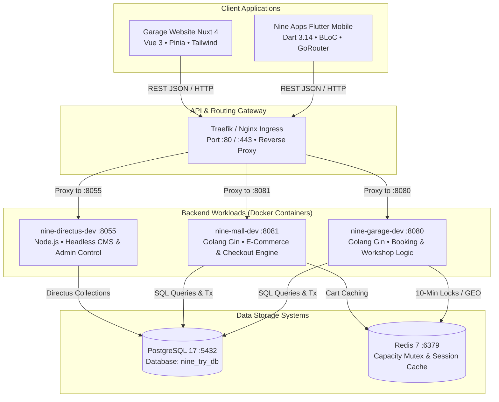
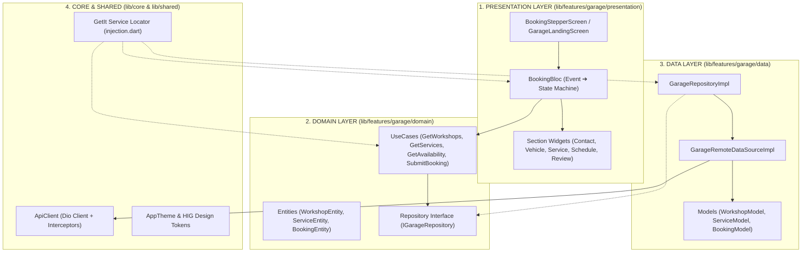

# 🏛️ Nine AutoSeries® Super-App — System Architecture & Infrastructure Blueprint

> **Standar Rekayasa:** C4 Architectural Model & Clean Distributed Systems  
> **Target Ekosistem:** Mobile Native (Flutter 3.50+), Web Portal (Nuxt 4 / Vue 3), Backend Services (Golang Gin), Database (PostgreSQL 17 HA & Redis 7 HA)  
> **Status:** Production-Ready (v1.0.0)

---

## 📑 Daftar Isi
1. [Tinjauan Arsitektur Tingkat Tinggi](#1-tinjauan-arsitektur-tingkat-tinggi)
2. [Model C4 Arsitektur Sistem](#2-model-c4-arsitektur-sistem)
   - 2.1 [Level 1: System Context Diagram](#21-level-1-system-context-diagram)
   - 2.2 [Level 2: Container Diagram](#22-level-2-container-diagram)
   - 2.3 [Level 3: Component Diagram (Flutter Mobile Client)](#23-level-3-component-diagram-flutter-mobile-client)
   - 2.4 [Level 4: Network & Deployment Topology](#24-level-4-network--deployment-topology)
3. [Arsitektur Klien Mobile (Flutter Feature-First Clean Architecture)](#3-arsitektur-klien-mobile-flutter-feature-first-clean-architecture)
4. [Protokol Jaringan, Interceptors & Idempotensi](#4-protokol-jaringan-interceptors--idempotensi)
5. [Integrasi Hardware & Aksesoris IoT](#5-integrasi-hardware--aksesoris-iot)
6. [Keamanan Data & Kontrol Konkurensi](#6-keamanan-data--kontrol-konkurensi)

---

## 1. Tinjauan Arsitektur Tingkat Tinggi

Ekosistem digital **Nine AutoSeries®** mengintegrasikan pengalaman pengguna multi-platform (*Omnichannel Mobility*) yang menghubungkan aplikasi mobile konsumen, portal operasional bengkel web, broker telemetri IoT berkecepatan tinggi, dan klaster basis data relasional:



---

## 2. Model C4 Arsitektur Sistem

### 2.1 Level 1: System Context Diagram
Diagram ini memperlihatkan batas sistem (*system boundary*) ekosistem Nine AutoSeries® beserta interaksi eksternalnya:



### 2.2 Level 2: Container Diagram
Diagram container memetakan seluruh aplikasi independen yang berjalan di dalam arsitektur:



### 2.3 Level 3: Component Diagram (Flutter Mobile Client)
Struktur komponen di dalam aplikasi mobile mengadopsi prinsip **Feature-First Clean Architecture**:



### 2.4 Level 4: Network & Deployment Topology
Topologi jaringan lokal Docker dan cluster target produksi:

```
┌──────────────────────────────────────────────────────────────────────────────┐
│                            INTERNET (PUBLIC WAN)                             │
│  [Mobile Klien: Android / iOS]               [Web Klien: Chrome / Safari]   │
└──────────────────────────────────────┬───────────────────────────────────────┘
                                       │ HTTPS (Port 443) / DNS Traefik
                                       ▼
┌──────────────────────────────────────────────────────────────────────────────┐
│                     GATEWAY TIER (LOCAL / K8S INGRESS)                       │
│  Traefik Edge Proxy:                                                         │
│  • /api/v1/workshops, /api/v1/bookings  ──► nine-garage-dev:8080            │
│  • /api/v1/products, /api/v1/cart       ──► nine-mall-dev:8081              │
│  • /assets, /items/*                    ──► nine-directus-dev:8055          │
└──────────────────────────────────────┬───────────────────────────────────────┘
                                       │ Docker Bridge Network / CNI
                                       ▼
┌──────────────────────────────────────────────────────────────────────────────┐
│                    APPLICATION SUBNET (BACKEND SERVICES)                     │
│  ┌───────────────────────────────┐     ┌──────────────────────────────────┐  │
│  │ nine-garage-dev (:8080)       │     │ nine-mall-dev (:8081)            │  │
│  └───────────────┬───────────────┘     └─────────────────┬────────────────┘  │
└──────────────────┼───────────────────────────────────────┼───────────────────┘
                   │ SQL Connection / Redis Protocol       │
                   ▼                                       ▼
┌──────────────────────────────────────────────────────────────────────────────┐
│                         DATA TIER (PERSISTENCE)                              │
│  ┌─────────────────────────────────┐   ┌──────────────────────────────────┐  │
│  │ PostgreSQL 17 (nine-postgres-dev)│  │ Redis 7 (nine-redis-dev)         │  │
│  │ Port: 5432 • DB: nine_try_db    │   │ Port: 6379 • DB Index 0 & 4     │  │
│  │ User: nine_dev                  │   │ Mutex Lock & Temporary Caching   │  │
│  └─────────────────────────────────┘   └──────────────────────────────────┘  │
└──────────────────────────────────────────────────────────────────────────────┘
```

---

## 3. Arsitektur Klien Mobile (Flutter Feature-First Clean Architecture)

Aplikasi mobile mengisolasi modul bisnis ke dalam folder `features/garage/` dengan hierarki berikut:

```
features/garage/
├── domain/                                    # Logika Bisnis Murni (Bebas Framework)
│   ├── entities/                              # Model entitas immutable
│   ├── repositories/                          # Kontrak antarmuka IGarageRepository
│   └── usecases/                              # Single Responsibility Use Cases
├── data/                                      # Sumber Data & Serialisasi
│   ├── datasources/                           # Remote API DataSource via Dio
│   ├── models/                                # DTO dengan mapping JSON (fromJson/toJson)
│   └── repositories/                          # Implementasi konkret repository
└── presentation/                              # Antarmuka Pengguna Reaktif
    ├── blocs/                                 # BLoC, Event, dan State Machine
    ├── screens/                               # Halaman penuh (Landing, Stepper, Success)
    └── widgets/                               # Komponen spesifik form booking
```

### Aliran Data Satu Arah (Unidirectional Data Flow - UDF):
1. **User Action:** Pengguna memilih cabang bengkel di `ScheduleSectionWidget`.
2. **Event Dispatched:** Widget memicu `SelectWorkshopEvent(workshop)` ke `BookingBloc`.
3. **State Mutation:** `BookingBloc` memanggil `GetAvailabilityUseCase` dan meng-emit state `BookingState(selectedWorkshop: ws, timeSlots: slots)`.
4. **Re-render:** `ScheduleSectionWidget` bereaksi dan menampilkan slot jam yang tersedia secara reaktif tanpa efek kedip (*smooth reactivity*).

---

## 4. Protokol Jaringan, Interceptors & Idempotensi

Setiap request HTTP dari aplikasi mobile diatur melalui 3 interceptor otomatis di dalam `ApiClient`:

1. **`AuthInterceptor`:** Menyuntikkan token `Authorization: Bearer <JWT>` secara otomatis jika sesi autentikasi tersedia.
2. **`IdempotencyInterceptor`:** Pada operasi mutasi data (`POST`, `PUT`, `PATCH`, `DELETE` — khususnya pembuatan booking servis `/bookings`), interceptor secara otomatis menyematkan header unik:
   ```http
   Idempotency-Key: 550e8400-e29b-41d4-a716-446655440000
   ```
   Hal ini menjamin bahwa jika koneksi terputus saat pengguna menekan tombol *"Konfirmasi Booking"*, pengiriman ulang tidak akan menghasilkan duplikasi tiket SPK di database.
3. **`ErrorInterceptor`:** Menerjemahkan respons status code HTTP (`400`, `401`, `422`, `500`) dan kegagalan jaringan menjadi objek `ServerException` dan `NetworkException` dengan pesan ramah non-teknis.

---

## 5. Integrasi Hardware & Aksesoris IoT

* **Smart LED Headlight & Demon Eye:** Dikendalikan secara nirkabel melalui Bluetooth Low Energy (**BLE 5.2**) menggunakan `flutter_blue_plus`. Mengirimkan frame biner HSV GATT langsung ke kontroler tanpa ketergantungan internet.
* **4K Smart Dashcam:** Menampilkan streaming langsung latensi rendah ($<350\text{ ms}$) menggunakan protokol **WebRTC WHEP** (`flutter_webrtc`) yang dialirkan melalui server MediaMTX.
* **GPS Telematics Tracker:** Membaca posisi satelit via API ingest Go/EMQX, ditampilkan di peta vektor OpenStreetMap menggunakan `maplibre_gl` (tanpa biaya Google Maps API).

---

## 6. Keamanan Data & Kontrol Konkurensi

1. **10-Minute Redis Capacity Lock:** Saat pengguna memilih slot jam dan memasuki tahap review, backend mengunci kapasitas mekanik di Redis selama 600 detik (`lock:slot:{workshop_id}:{date}:{slot}`) untuk mencegah *double booking* antar pelanggan.
2. **Enkripsi PII Data Pelanggan:** Nama, nomor telepon, dan plat nomor dilindungi sesuai UU PDP No. 27/2022.
3. **Audit Logging:** Setiap perubahan status tiket booking dicatat di tabel `audit_logs` dengan timestamp atomik server.
