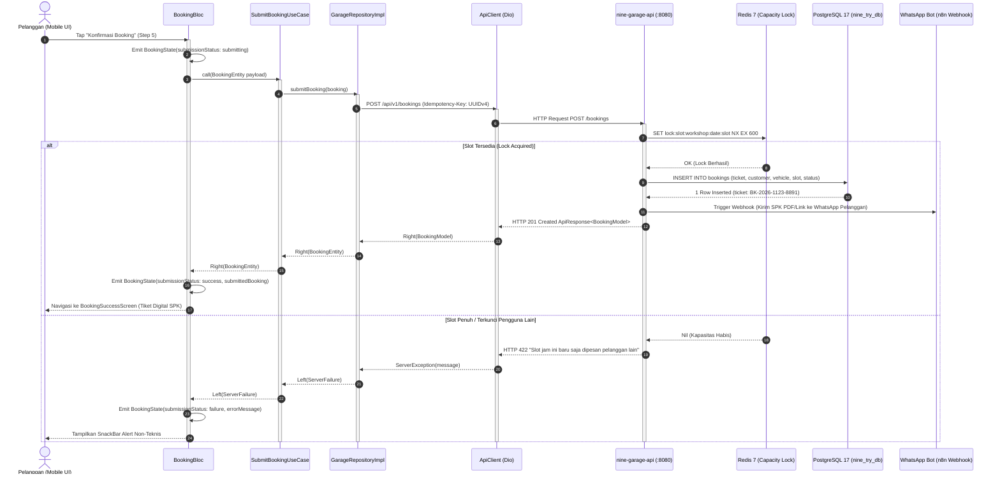
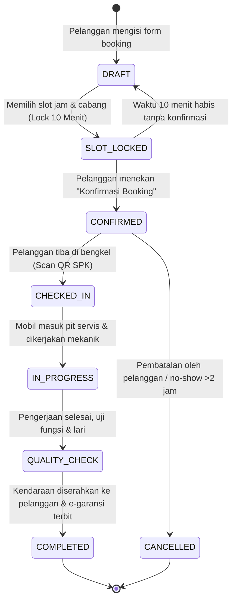
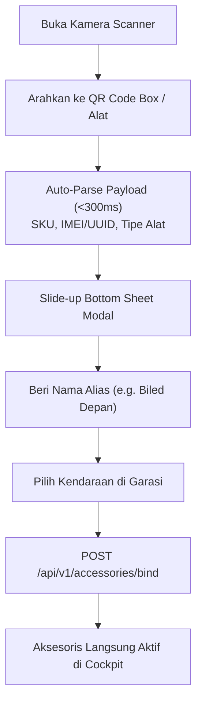
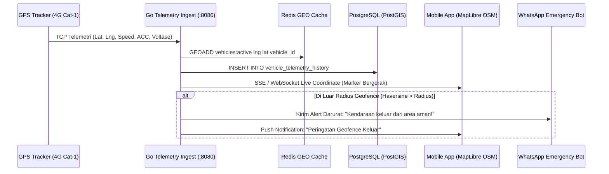

# 🔄 Nine AutoSeries® — Master Business Flows & Sequential Specifications

> **Dokumentasi Alur Bisnis:** Panduan Alur Operasional End-to-End, Sequential Sequence Diagrams, dan State Machines  
> **Modul Fokus Utama:** Nine Garage (Booking Servis & Digital SPK), Aksesoris IoT, dan Nine Mall Flywheel  
> **Status:** Production-Ready (v1.0.0)

---

## 📑 Daftar Isi
1. [Alur Bisnis Utama: Reservasi Servis Nine Garage (5-Step Wizard)](#1-alur-bisnis-utama-reservasi-servis-nine-garage-5-step-wizard)
2. [Diagram Sekuensial (Sequence Diagram) Booking Servis](#2-diagram-sekuensial-sequence-diagram-booking-servis)
3. [State Machine Lifecycle: Siklus Hidup Tiket SPK](#3-state-machine-lifecycle-siklus-hidup-tiket-spk)
4. [Alur Onboarding & Pairing Aksesoris (Zero-Friction Scanner)](#4-alur-onboarding--pairing-aksesoris-zero-friction-scanner)
5. [Alur Telematika GPS & Sistem Proteksi Geofence](#5-alur-telematika-gps--sistem-proteksi-geofence)
6. [Alur E-Commerce & Checkout Nine Mall](#6-alur-e-commerce--checkout-nine-mall)

---

## 1. Alur Bisnis Utama: Reservasi Servis Nine Garage (5-Step Wizard)

Alur reservasi servis bengkel dirancang dengan prinsip **Zero Friction & High Accuracy**, memandu pelanggan melalui 5 langkah terstruktur yang selaras dengan antarmuka web dan mobile:

```
┌──────────────────┐    ┌──────────────────┐    ┌──────────────────┐    ┌──────────────────┐    ┌──────────────────┐
│  1. KONTAK & WA  │ ──►│  2. KENDARAAN    │ ──►│  3. JASA SERVIS  │ ──►│  4. JADWAL SLOT  │ ──►│  5. REVIEW & SPK │
│ Nama, No WA,     │    │ Merek, Model,    │    │ Biled, Klakson,  │    │ Pilih Bengkel,   │    │ Cek Rincian,     │
│ Alamat, Catatan  │    │ Plat No, Trans   │    │ Garansi Resmi    │    │ Kunci Slot 10 Mnt│    │ Terbitkan SPK    │
└──────────────────┘    └──────────────────┘    └──────────────────┘    └──────────────────┘    └──────────────────┘
```

### Rincian Per Tahap:
* **Tahap 1: Kontak Pelanggan:**
  - Input nama lengkap dan nomor WhatsApp aktif.
  - Validasi regex nomor telepon Indonesia ($9 - 15$ digit numerik).
  - Catatan keluhan kendaraan atau permintaan khusus modifikasi.
* **Tahap 2: Detail Kendaraan:**
  - Pemilihan kategori kendaraan (Mobil / Motor).
  - Pemilihan merek (Toyota, Honda, Mitsubishi, dll) dan model kendaraan.
  - Input nomor polisi (Plat Nomor) dengan format huruf besar otomatis.
  - Pemilihan tipe transmisi (Otomatis / Manual) untuk penyesuaian pit bengkel.
* **Tahap 3: Pemilihan Jasa Layanan:**
  - Menampilkan katalog jasa instalasi resmi Nine (Single Biled, Lampu Tembak, Klakson, dll).
  - Menampilkan harga promo transparan (`now_price`) dan lencana garansi resmi.
  - Menghitung akumulasi estimasi durasi pengerjaan mekanik dalam satuan menit.
* **Tahap 4: Jadwal & Lokasi Bengkel:**
  - Pemilihan cabang bengkel fisik (contoh: Arcadia Daan Mogot).
  - Pemilih tanggal kedatangan dari kalender 14 hari kedepan.
  - Pemilihan slot jam (`09:00`, `10:00`, `11:00`, `13:00`, dll) dengan validasi kapasitas pit.
* **Tahap 5: Review & Digital SPK:**
  - Ringkasan komprehensif data kontak, kendaraan, jasa, dan jadwal.
  - Input kode promo voucher (contoh: `NINE50K` potongan Rp 50.000).
  - Konfirmasi final yang menerbitkan tiket **Digital Work Order (SPK)** berformat `BK-2026-XXXX`.

---

## 2. Diagram Sekuensial (Sequence Diagram) Booking Servis

Diagram sekuensial ini memetakan interaksi antar komponen sistem dari penekanan tombol di ponsel hingga penerbitan tiket di database:



---

## 3. State Machine Lifecycle: Siklus Hidup Tiket SPK

Tiket reservasi servis bergerak melalui status mesin (*Finite State Machine*) berikut:



### Definisi Status SPK:
* **`DRAFT`:** Pengguna sedang mengisi data di aplikasi.
* **`SLOT_LOCKED`:** Kapasitas mekanik di-reserve di Redis selama 600 detik.
* **`CONFIRMED`:** Tiket resmi diterbitkan, tercatat di database, dan notifikasi WhatsApp terkirim.
* **`CHECKED_IN`:** Pelanggan tiba di resepsionis bengkel dan memindai QR code tiket SPK.
* **`IN_PROGRESS`:** Mekanik sedang memasang suku cadang atau melakukan retrofit di pit servis.
* **`QUALITY_CHECK`:** Uji pencahayaan biled (lux meter / cut-off line) dan fungsi kelistrikan.
* **`COMPLETED`:** Servis selesai, transaksi lunas, dan e-garansi otomatis aktif di aplikasi.
* **`CANCELLED`:** Reservasi dibatalkan sebelum hari H.

---

## 4. Alur Onboarding & Pairing Aksesoris (Zero-Friction Scanner)

Alur penautan hardware (Smart LED, Dashcam, GPS) ke kendaraan di garasi:



---

## 5. Alur Telematika GPS & Sistem Proteksi Geofence

Pemantauan satelit real-time dan deteksi anomali:



---

## 6. Alur E-Commerce & Checkout Nine Mall

Alur pembelian sparepart mandiri terintegrasi:
1. **Vehicle Matchmaker:** Pengguna memilih kendaraan aktif $\rightarrow$ katalog otomatis memfilter produk yang 100% kompatibel (*Plug & Play*).
2. **Keranjang Parsial:** Item disimpan di Redis dengan validasi ketersediaan stok gudang terdekat.
3. **Pengiriman J&T:** Kalkulasi otomatis berat barang dan tarif pengiriman via API J&T.
4. **Pembayaran Midtrans Snap:** Pelanggan memilih metode QRIS / Virtual Account bank.
5. **Konfirmasi Otomatis:** Webhook Midtrans mengupdate status pesanan menjadi `PAID` dan menerbitkan nomor resi otomatis.
