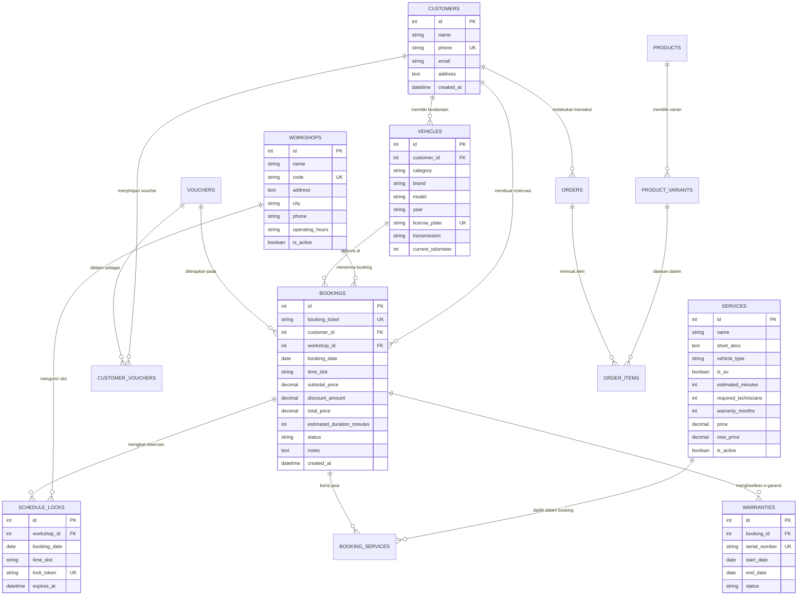

# 🗄️ Nine AutoSeries® — Database Schema, ERD & Data Dictionary

> **Spesifikasi Database:** PostgreSQL 17.8 Relational Data Tier (`nine_try_db`)  
> **Konvensi Penamaan:** Snake_case, Foreign Keys bertipe integer / UUID, Timestamp UTC / Asia/Jakarta dengan Timezone  
> **Karakteristik:** 106 Tabel Aktif, Multi-Tenant Bengkel, Directus CMS Integration, Full Audit Trail  

---

## 📑 Daftar Isi
1. [Diagram Relasi Entitas (Entity-Relationship Diagram / ERD)](#1-diagram-relasi-entitas-entity-relationship-diagram--erd)
2. [Kamus Data Modul Nine Garage (Data Dictionary)](#2-kamus-data-modul-nine-garage-data-dictionary)
   - 2.1 [Tabel `bookings` (Reservasi Servis & Digital SPK)](#21-tabel-bookings-reservasi-servis--digital-spk)
   - 2.2 [Tabel `workshops` (Cabang Bengkel Resmi)](#22-tabel-workshops-cabang-bengkel-resmi)
   - 2.3 [Tabel `services` (Katalog Jasa & Instalasi)](#23-tabel-services-katalog-jasa--instalasi)
   - 2.4 [Tabel `schedule_locks` (Penguncian Kapasitas 10 Menit)](#24-tabel-schedule_locks-penguncian-kapasitas-10-menit)
3. [Kamus Data Modul Pelanggan & Kendaraan](#3-kamus-data-modul-pelanggan--kendaraan)
   - 3.1 [Tabel `customers` (Data Pelanggan)](#31-tabel-customers-data-pelanggan)
   - 3.2 [Tabel `vehicles` (Garasi Kendaraan Digital)](#32-tabel-vehicles-garasi-kendaraan-digital)
4. [Kamus Data Modul E-Commerce (Nine Mall)](#4-kamus-data-modul-e-commerce-nine-mall)
   - 4.1 [Tabel `products` & `product_variants`](#41-tabel-products--product_variants)
   - 4.2 [Tabel `orders` & `order_items`](#42-tabel-orders--order_items)
5. [Strategi Pengindeksan & Audit Integritas Data DDL](#5-strategi-pengindeksan--audit-integritas-data-ddl)

---

## 1. Diagram Relasi Entitas (Entity-Relationship Diagram / ERD)



---

## 2. Kamus Data Modul Nine Garage (Data Dictionary)

### 2.1. Tabel `bookings` (Reservasi Servis & Digital SPK)
Menyimpan riwayat dan status tiket pesanan servis bengkel:

| Nama Kolom | Tipe Data | Nullable | Default | Keterangan & Aturan Bisnis |
| :--- | :--- | :---: | :---: | :--- |
| `id` | `BIGSERIAL` | NO | Auto | Primary Key internal database. |
| `booking_ticket` | `VARCHAR(32)` | NO | - | **Unique Ticket Number** resmi (contoh: `BK-2026-1123-8891`). |
| `customer_id` | `INT` | YES | NULL | Relasi ke `customers.id` jika pelanggan sudah terdaftar. |
| `customer_name` | `VARCHAR(150)` | NO | - | Nama lengkap pemesan (denormalisasi untuk cetak SPK instan). |
| `customer_phone` | `VARCHAR(20)` | NO | - | Nomor WhatsApp tujuan pengiriman SPK PDF/Link. |
| `customer_email`| `VARCHAR(150)` | YES | NULL | Alamat email faktur/tanda terima digital. |
| `address` | `TEXT` | YES | NULL | Alamat domisili pelanggan. |
| `vehicle_category`| `VARCHAR(20)` | NO | `'car'` | `'car'` (Mobil) atau `'motorcycle'` (Motor). |
| `vehicle_brand` | `VARCHAR(60)` | NO | - | Merek mobil/motor (Toyota, Honda, dll). |
| `vehicle_model` | `VARCHAR(100)`| NO | - | Tipe model (Innova Zenix, Fortuner, NMAX). |
| `vehicle_year` | `VARCHAR(4)` | YES | NULL | Tahun perakitan kendaraan. |
| `license_plate` | `VARCHAR(20)` | NO | - | Nomor polisi (contoh: `B 1234 NNE`). |
| `transmission_type`| `VARCHAR(20)`| NO | `'automatic'`| `'automatic'` atau `'manual'`. |
| `workshop_id` | `INT` | NO | - | Foreign Key ke `workshops.id`. |
| `booking_date` | `DATE` | NO | - | Tanggal kedatangan servis bengkel. |
| `time_slot` | `VARCHAR(10)` | NO | - | Jam kedatangan terpilih (`09:00`, `10:00`, `14:00`). |
| `subtotal_price`| `NUMERIC(14,2)`| NO | `0.00` | Akumulasi harga jasa normal/promo. |
| `discount_amount`| `NUMERIC(14,2)`| NO | `0.00` | Nilai potongan voucher kupon diskon. |
| `total_price` | `NUMERIC(14,2)`| NO | `0.00` | Total biaya akhir (`subtotal - discount`). |
| `estimated_duration_minutes` | `INT` | NO | `60` | Total durasi servis yang diakumulasi. |
| `notes` | `TEXT` | YES | NULL | Catatan keluhan mekanis dari pelanggan. |
| `status` | `VARCHAR(30)` | NO | `'PENDING'` | `PENDING`, `CHECKED_IN`, `IN_PROGRESS`, `COMPLETED`, `CANCELLED`. |
| `created_at` | `TIMESTAMPTZ` | NO | `NOW()` | Timestamp pembuatan reservasi. |
| `updated_at` | `TIMESTAMPTZ` | NO | `NOW()` | Timestamp pembaruan data terakhir. |

### 2.2. Tabel `workshops` (Cabang Bengkel Resmi)
Daftar cabang fisik bengkel Nine AutoSeries:

| Nama Kolom | Tipe Data | Nullable | Keterangan |
| :--- | :--- | :---: | :--- |
| `id` | `SERIAL` | NO | Primary Key. |
| `name` | `VARCHAR(100)` | NO | Nama cabang (e.g. "Arcadia Daan Mogot (Pusat)"). |
| `code` | `VARCHAR(10)` | NO | Kode unik cabang (e.g. `TGR`, `JKT`). |
| `address` | `TEXT` | NO | Alamat lengkap fisik bengkel. |
| `city` | `VARCHAR(60)` | NO | Kota lokasi bengkel. |
| `phone` | `VARCHAR(20)` | YES | Nomor telepon kantor cabang. |
| `operating_hours`| `VARCHAR(50)` | YES | Jam buka operasional (`09:00 - 18:00`). |
| `is_active` | `BOOLEAN` | NO | Status penerimaan servis baru (`TRUE`/`FALSE`). |

### 2.3. Tabel `services` (Katalog Jasa & Instalasi)
Daftar jasa instalasi retrofit resmi:

| Nama Kolom | Tipe Data | Nullable | Keterangan |
| :--- | :--- | :---: | :--- |
| `id` | `SERIAL` | NO | Primary Key. |
| `name` | `VARCHAR(150)` | NO | Nama jasa (e.g. "Jasa Single Biled Projector"). |
| `short_desc` | `TEXT` | YES | Ringkasan cakupan pengerjaan jasa. |
| `vehicle_type`| `VARCHAR(20)` | NO | Target kendaraan (`car`, `motorcycle`, `all`). |
| `is_ev` | `BOOLEAN` | NO | Flag instalasi pada kendaraan listrik EV. |
| `estimated_minutes` | `INT` | NO | Durasi waktu standar mekanik (menit). |
| `required_technicians` | `INT` | NO | Jumlah teknisi yang dibutuhkan per pit. |
| `warranty_months` | `INT` | NO | Durasi jaminan garansi resmi (bulan). |
| `price` | `NUMERIC(14,2)` | NO | Harga retail normal (sebelum promo). |
| `now_price` | `NUMERIC(14,2)` | NO | Harga aktif yang dibayarkan pelanggan saat ini. |
| `image_url` | `TEXT` | YES | Foto contoh hasil instalasi. |
| `is_active` | `BOOLEAN` | NO | Status ketersediaan layanan. |

### 2.4. Tabel `schedule_locks` (Penguncian Kapasitas 10 Menit)
Penyimpanan kunci slot sementara berbasis database/Redis:

| Nama Kolom | Tipe Data | Nullable | Keterangan |
| :--- | :--- | :---: | :--- |
| `id` | `BIGSERIAL` | NO | Primary Key. |
| `workshop_id` | `INT` | NO | Relasi ke cabang bengkel target. |
| `booking_date` | `DATE` | NO | Tanggal yang dikunci. |
| `time_slot` | `VARCHAR(10)` | NO | Jam yang dikunci (`10:00`). |
| `lock_token` | `VARCHAR(64)` | NO | Token UUID pengunci sesi pengguna. |
| `expires_at` | `TIMESTAMPTZ` | NO | Waktu kedaluwarsa kunci (`NOW() + 10 MINUTES`). |

---

## 3. Kamus Data Modul Pelanggan & Kendaraan

### 3.1. Tabel `customers` (Data Pelanggan)
* `id` (`INT PK`), `name` (`VARCHAR`), `phone` (`VARCHAR UNIQUE`), `email` (`VARCHAR`), `address` (`TEXT`), `nine_koin_balance` (`INT`).

### 3.2. Tabel `vehicles` (Garasi Kendaraan Digital)
* `id` (`INT PK`), `customer_id` (`INT FK`), `category` (`car/motorcycle`), `brand` (`VARCHAR`), `model` (`VARCHAR`), `year` (`VARCHAR`), `license_plate` (`VARCHAR UNIQUE`), `transmission` (`automatic/manual`), `current_odometer` (`INT`), `battery_voltage` (`DECIMAL`).

---

## 4. Kamus Data Modul E-Commerce (Nine Mall)

### 4.1. Tabel `products` & `product_variants`
* `products`: `id` (`INT PK`), `name`, `slug`, `category_id`, `brand_id`, `description`, `is_published`.
* `product_variants`: `id` (`INT PK`), `product_id` (`INT FK`), `sku` (`VARCHAR UNIQUE`), `name`, `price`, `stock`, `weight_grams`.

### 4.2. Tabel `orders` & `order_items`
* `orders`: `id` (`INT PK`), `order_number` (`VARCHAR UNIQUE`), `customer_id`, `total_amount`, `payment_status` (`PENDING/PAID/EXPIRED`), `snap_token`.
* `order_items`: `id` (`INT PK`), `order_id` (`INT FK`), `variant_id` (`INT FK`), `quantity`, `unit_price`, `subtotal`.

---

## 5. Strategi Pengindeksan & Audit Integritas Data DDL

### 5.1. Indeks Kritis Performa
```sql
-- Indeks pencarian cepat tiket SPK
CREATE UNIQUE INDEX idx_bookings_ticket ON bookings(booking_ticket);

-- Indeks pencarian riwayat pelanggan via nomor WhatsApp
CREATE INDEX idx_bookings_customer_phone ON bookings(customer_phone);

-- Indeks pencarian ketersediaan slot cabang dan tanggal
CREATE INDEX idx_bookings_workshop_date ON bookings(workshop_id, booking_date, time_slot);

-- Indeks plat nomor unik kendaraan di garasi
CREATE UNIQUE INDEX idx_vehicles_license_plate ON vehicles(license_plate);
```

### 5.2. Prosedur Audit Data Pasca-Testing
Sesuai SOP pengujian, setiap penyelesaian pengujian E2E wajib melakukan verifikasi audit SQL langsung ke basis data lokal:

```bash
docker exec -e PGPASSWORD=nine_dev_password nine-postgres-dev psql -U nine_dev -d nine_try_db -c "
SELECT booking_ticket, customer_name, vehicle_brand, vehicle_model, license_plate, total_price, status 
FROM bookings 
ORDER BY id DESC LIMIT 5;
"
```
Verifikasi memastikan bahwa:
1. Kolom tidak terpotong (*no truncation*).
2. Format nomor telepon terstandarisasi.
3. Total harga (`total_price`) sama persis dengan `subtotal - discount`.
